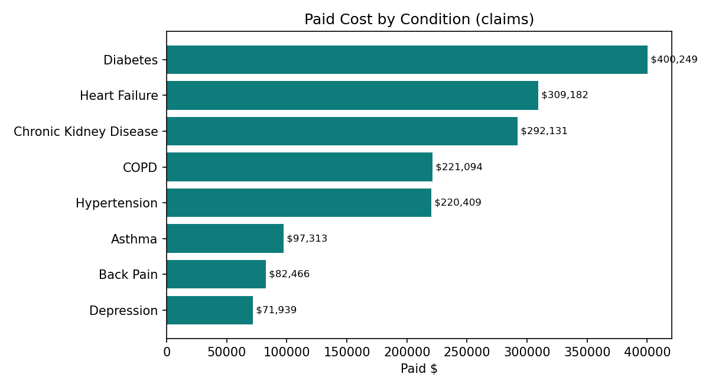
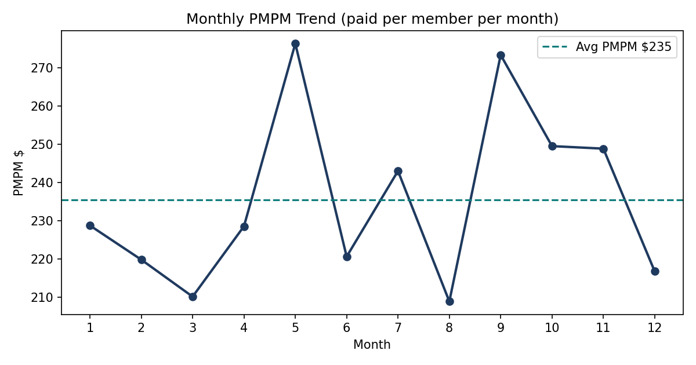
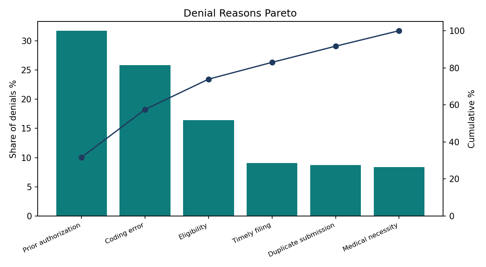
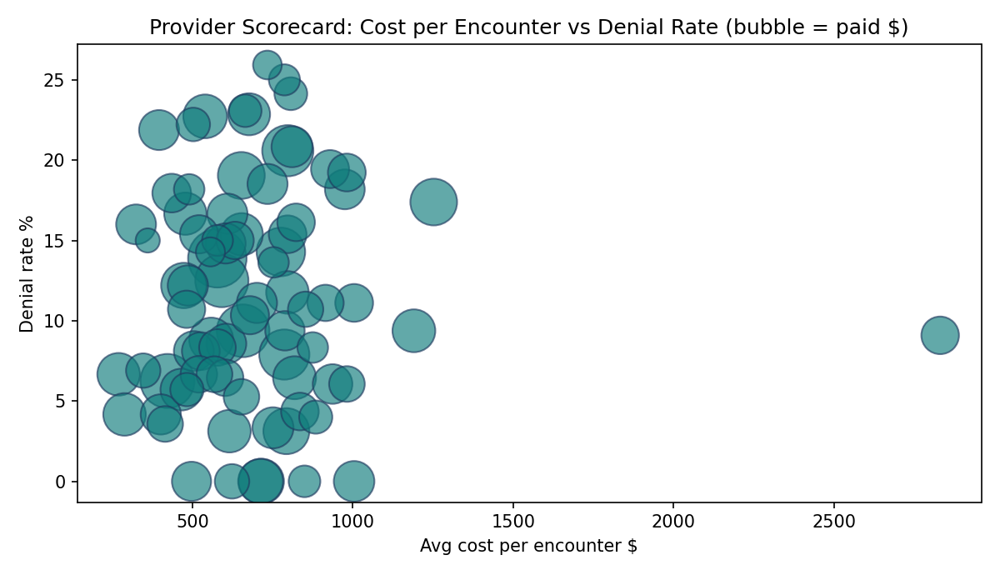

# Healthcare Claims and Cost Analytics: Claim Denials, Cost per Member and Readmissions

## In simple words — what is this project?

This project is my CVS Health data analyst job, done as one project.

I took 4 lists of healthcare data — patients, doctors, insurance claims and hospital visits.
I joined them together and cleaned them (removed duplicates, fixed missing values, checked wrong amounts).
Then I answered the normal questions a healthcare company asks every week:
- How much money did we pay on claims? ($1.69 million)
- How many claims were denied, and why? (11.5% denied; the top reason is missing prior authorization, 31.7%)
- How much does one member cost per month? ($235.39 — this is called PMPM)
- Which diseases cost the most money? (Diabetes, heart failure and kidney disease = 59.1% of all cost)
- How many patients came back to hospital within 30 days? (25.5% of hospital patients — readmission)
- Which doctors get the most claims denied? (from 0% to 25.9%)

Finally I built a dashboard and reports so a manager can see all these numbers in one page.
Tools used: SQL, Python, Power BI, Tableau — the same tools from my 90-day study plan.

     

> **Portfolio project — synthetic CMS-style data only. No PHI, no real patients, no employer data.** Built to mirror, end to end, the full job of a Healthcare Data Analyst at a payer / health company such as CVS Health.

## Why this project is different
Most portfolio projects show one chart. A real healthcare analyst job is a **pipeline plus five recurring responsibility areas**, and this repo is structured exactly that way — one data pipeline feeding five analysis modules, each with its own KPIs, SQL, outputs and dashboard page:

| Module | Real-world responsibility | What it answers |
|---|---|---|
| 0 — Pipeline | Ingest, clean, model, validate multi-source data | Can we trust this data? |
| 1 — Claims & Revenue Cycle | Claims reporting, denial management support | What was billed vs paid, and why are claims denied? |
| 2 — Cost & Utilization | Medical cost reporting, PMPM, utilization | What does care cost per member, and what drives it? |
| 3 — Patient Outcomes | Quality / outcomes reporting | How big are readmissions and high-cost patient concentration? |
| 4 — Provider Performance | Provider scorecards for network teams | Which providers are outliers, good or bad? |

## Headline KPIs (actual outputs of `analysis.py`)
| KPI | Value |
|---|---|
| Members / providers / claims / encounters | 600 / 80 / 2,500 / 1,200 |
| Total billed | $2,400,677 |
| Total paid | $1,694,783 |
| Paid ratio | 70.6% |
| Denial rate | 11.5% |
| Top denial reason | Prior authorization — 31.7% of denials |
| PMPM (per member per month) | **$235.39** |
| Average cost per encounter | $686.15 |
| Encounters per 1,000 members | 2,000 |
| Top-3 conditions' share of paid | **59.1%** (Diabetes 23.6%, Heart Failure 18.2%, CKD 17.2%) |
| Readmission proxy — all encounters / inpatient | 3.8% / **25.5%** |
| Cost share of top 10% of patients | 25.7% |
| Highest provider denial rate | PR073 (Orthopedics) — 25.9% |
| Lowest provider denial rate (≥20 claims) | PR058 (Primary Care) — 0.0% |

## Dashboard






## Key insights (per module)
- **Module 0:** All 4,380 loaded rows pass structural checks — zero duplicate keys, zero orphan foreign keys, denied ⇒ paid = 0, paid ≤ billed.
- **Module 1:** Denials are a Pareto problem: Prior authorization (31.7%) + Coding error (25.8%) = 57.5% of all denials. Fixing front-end authorization and coding workflows attacks most of the 11.5% denial rate.
- **Module 2:** Chronic concentration is the budget: Diabetes, Heart Failure and CKD are 59.1% of paid dollars on 41% of claims. PMPM of $235.39 is the baseline any cost initiative must move.
- **Module 3:** The inpatient readmission proxy (25.5%) is the quality team's target; the top 10% of patients driving 25.7% of cost is the care-management cohort — and the overlap of the two groups is where intervention pays first.
- **Module 4:** Scorecards separate signal from noise with volume context: PR073's 25.9% denial rate (27 claims) warrants review, while PR058 (Primary Care) runs 0.0% denials at comparable volume — a workflow worth copying.

## Business questions this project answers
- **Revenue cycle:** What is our paid ratio, and which denial reasons — by count and by billed dollars at risk — should the denial-management team attack first?
- **Finance / actuarial support:** What is PMPM this month, is it trending up, and how much of it is chronic-condition cost versus everything else?
- **Utilization management:** Are members using the ER and inpatient settings at rates (per 1,000 members) that suggest access or care-management problems?
- **Quality / outcomes:** How large is the 30-day readmission problem, for which conditions, and which patients — the high-cost decile — should care management enrol first?
- **Network / provider relations:** Which providers are denial or cost outliers once volume is accounted for, and which high performers' workflows should be studied and replicated?

## Data design (why the synthetic data is shaped this way)
The generator (seed 42) weights conditions by realistic prevalence and cost: Heart Failure and Chronic Kidney Disease carry cost multipliers of 2.2× and 2.4× against a Hypertension baseline of 0.8×, which is what produces the 59.1% top-3 concentration the analysis then "discovers". Provider behaviour is also planted, not random: a small number of providers bill at 1.4–1.55× peer levels with elevated denial propensity, and one efficient provider bills at 0.62× with a 4% denial propensity — Module 4's scorecard has to find them from the data alone, the same way a real scorecard must. Readmission probability is encounter-type- and condition-dependent (22% base for inpatient stays, uplifted for Heart Failure, COPD and CKD), mirroring the clinical pattern that readmission risk concentrates in chronic, recently-discharged patients. Denial reasons follow a front-end-heavy distribution (prior authorization and coding errors first), consistent with published revenue-cycle benchmarks where most denials are administrative rather than clinical.

## Data files (all in `data/`)
- `patients.csv` — 600 members: age, gender, payer (insurance type), months enrolled, number of chronic conditions
- `providers.csv` — 80 providers (doctors/clinics): specialty and region
- `claims.csv` — 2,500 insurance claims: amount billed, amount paid (0 when denied), paid/denied status, denial reason
- `encounters.csv` — 1,200 hospital and clinic visits: visit type, cost, and a flag for "came back within 30 days"

How the headline numbers are calculated: Paid ratio = paid ÷ billed · Denial rate = denied claims ÷ all claims · PMPM = total paid ÷ member-months · Readmission rate = share of visits flagged as a return within 30 days.

## Repository structure
```
├── analysis.py             # runs Modules 0–4, writes all outputs
├── charts.py               # 4 matplotlib charts -> images/
├── requirements.txt  LICENSE  .gitignore
├── data/                   # patients.csv, providers.csv, claims.csv, encounters.csv
├── sql/analysis_queries.sql  # 10+ queries across all modules
├── outputs/                # kpi_summary.csv, provider_scorecard.csv, cost_by_condition.csv
├── images/                 # cost_by_condition, monthly_pmpm_trend, denial_pareto, provider_scorecard_scatter
```

## How to run
```bash
pip install -r requirements.txt
python3 analysis.py        # Modules 0–4 -> outputs/
python3 charts.py          # -> images/
```

## SQL highlights (`sql/analysis_queries.sql`)
Denial Pareto with window-function cumulative share · PMPM overall and monthly · cost-by-condition with chronic concentration · encounters per 1,000 members · readmission by condition with `RANK()` · top-decile patient cost concentration (CTE + `ROW_NUMBER()`) · provider scorecard with `RANK()` over denial rate.

## Interview Q&A
1. **How is PMPM calculated, and what breaks it?** Total paid ÷ member-months. It breaks when enrollment churn is ignored — the denominator must be member-months, not headcount.
2. **Your first denial-reduction move?** Pareto first: prior-auth and coding errors are 57.5% of denials here, so workflow fixes beat provider-by-provider chasing.
3. **Is the readmission number real?** It's a *proxy* — a pre-flagged return within 30 days on synthetic data. In production I'd derive it by linking an index admission to the next inpatient encounter per patient and state the definition (planned vs unplanned) explicitly.
4. **Why a star schema for this?** Claims and encounters are facts at different grains; patients/providers/conditions are conformed dimensions, so every module slices the same trusted tables instead of rebuilding extracts.
5. **How do you avoid shaming a provider on a scorecard unfairly?** Volume and case-mix context on every metric, minimum-volume thresholds for rankings, and rates shown next to raw counts — exactly how `provider_scorecard.csv` is built.

## 60-second talk track
"This project replicates a healthcare data analyst's full job at a payer. I built one pipeline that ingests patients, providers, claims and encounters into a star schema with automated data-quality checks, then five modules on top: revenue cycle — $1.69 million paid on $2.40 million billed with an 11.5% denial rate driven mainly by prior-authorization failures; cost and utilization — PMPM of $235 with three chronic conditions driving 59% of spend; outcomes — a 25.5% inpatient readmission proxy and a top-decile of patients driving a quarter of cost; and provider scorecards that flag a 25.9% denial-rate outlier against a 0% best performer. Everything — SQL, Python, dashboard and tests — is in the repo and reproducible from one command sequence."

## Next steps
