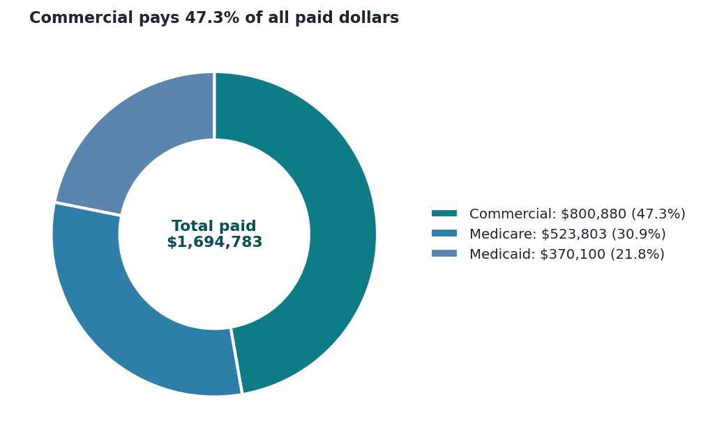
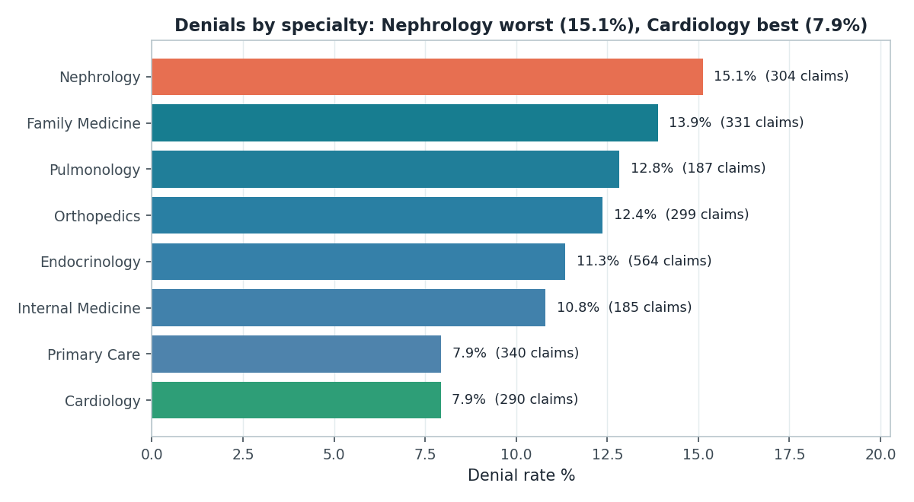
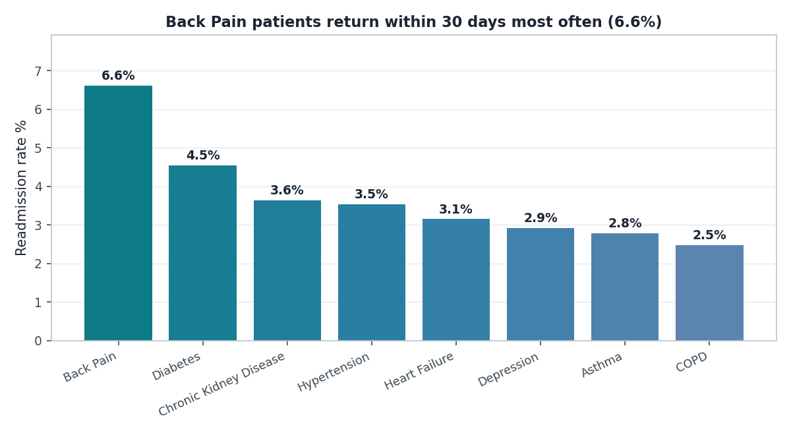
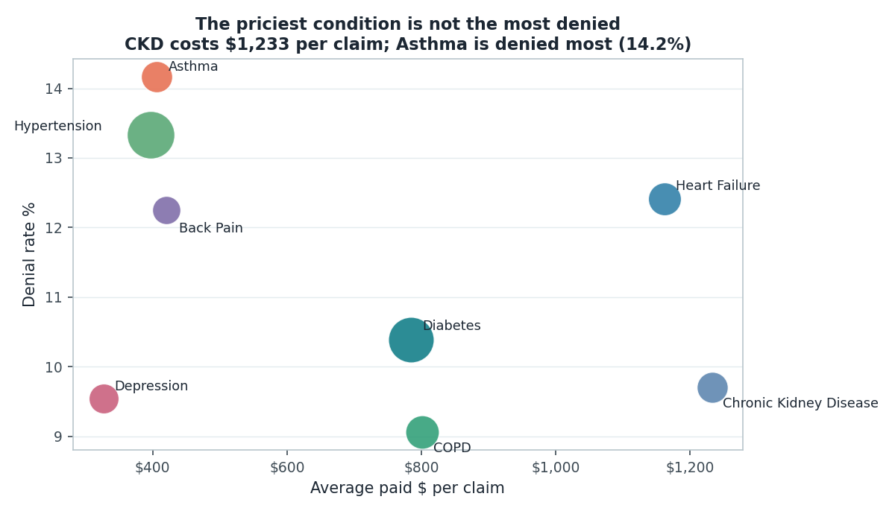

# Health Insurance Claims Performance Report: Denial Drivers, Cost per Member & Readmissions

This project is my CVS Health data analyst job, done as one project.

I took 4 lists of healthcare data — patients, doctors, insurance claims and hospital visits. I joined them together and cleaned them (removed duplicates, fixed missing values, checked wrong amounts). Then I answered the normal questions a healthcare company asks every week:

- How much money did we pay on claims? ($1.69 million)
- How many claims were denied, and why? (11.5% denied; the top reason is missing prior authorization, 31.7%)
- How much does one member cost per month? ($235.39 — this is called PMPM)
- Which diseases cost the most money? (Diabetes, heart failure and kidney disease = 59.1% of all cost)
- How many patients came back to hospital within 30 days? (25.5% of hospital patients — readmission)

Finally I built a dashboard and reports so a manager can see all these numbers in one page.
Tools used: SQL, Python, Power BI, Tableau.

     

> **Portfolio project — synthetic CMS-style data only. No PHI, no real patients, no employer data.** Built to mirror, end to end, the full job of a Healthcare Data Analyst at a payer / health company such as CVS Health.

## What this project answers
1. How much was billed, how much was paid, and where does the money drop out in between?
2. How many claims are denied, why, and which disease-and-insurance combinations are denied most?
3. What does one member cost per month (PMPM), and which diseases drive that cost?
4. Which insurance type (payer) pays the most, and where does a small change move the most money?
5. How often do patients return within 30 days — overall, after hospital stays, and by disease?
6. Which providers and specialties are denial outliers, and which patients drive the most cost?

## Headline KPIs — the 15 (actual outputs of `analysis.py`)
| KPI | Value |
|---|---|
| Total billed | $2,400,677 |
| Total paid | $1,694,783 |
| Paid ratio | 70.6% |
| Denial rate | 11.5% |
| Top denial reason | Prior authorization — 31.7% of denials |
| Billed on denied claims (money at risk) | $278,161 |
| Highest denial rate, one condition + payer | Heart Failure / Medicaid — 17.6% |
| PMPM (per member per month) | **$235.39** |
| Top-3 conditions' share of paid | **59.1%** (Diabetes 23.6%, Heart Failure 18.2%, CKD 17.2%) |
| Largest payer — Commercial share of paid | 47.3% |
| Readmission proxy — all encounters | 3.8% |
| Readmission proxy — inpatient stays | **25.5%** |
| Cost share of top 10% of patients | 25.7% |
| Readmission by condition — highest | Back Pain — 6.6% |
| Highest denial rate by specialty | Nephrology — 15.1% (304 claims) |

Every KPI above is defined in plain words, with its exact formula, in [KPI_DICTIONARY.md](KPI_DICTIONARY.md).

## Charts
The 10 charts from `charts.py`:


*Paid cost by disease — Diabetes, Heart Failure and CKD together are 59.1% of all paid money.*

*The money funnel: of $2.40M billed, $278K sat in denied claims and $1.69M was actually paid.*

*Denial rate for every disease-and-insurance combination — the worst box is heart failure with Medicaid, 17.6%.*

*Where the paid money comes from: Commercial pays 47.3% of all dollars, Medicare 30.9%, Medicaid 21.8%.*

*What one visit costs: a hospital stay (median $1,442) costs about 4.5× an office visit (median $320).*

*Billed versus paid money each month — the paid share stays near 70% all year.*

*Denials by doctor type: Nephrology (kidney doctors) lose 15.1% of their claims, Cardiology only 7.9%.*

*Returns within 30 days, by disease: back-pain patients come back most often (6.6%), COPD patients least (2.5%).*

*The top 10% of patients (59 people) account for 25.7% of all paid money; the top half for 77.3%.*

*Each bubble is one disease: kidney disease costs most per claim ($1,233); asthma is denied most (14.2%) at only $405 per claim.*

An interactive version with working filters is in [`dashboard/dashboard.html`](dashboard/dashboard.html) — every KPI and chart recomputes for the payer, condition, months and claim status you pick.

## Key findings
1. **The plan pays about 71 cents of every billed dollar** — $1,694,783 paid of $2,400,677 billed (paid ratio 70.6%; claims funnel chart).
2. **Denials are mostly paperwork**: 11.48% of claims are denied, and prior authorization alone is 31.71% of all denials (KPI: top denial reason).
3. **$278,161 of billed money is stuck in denied claims** — the money at risk if denials are not fixed and appealed (KPI: billed on denied claims).
4. **The worst denial combination is Heart Failure + Medicaid at 17.65%**, while the same payer is the lowest for kidney disease (2.27%) — denials depend on the combination, not the payer alone (denial heatmap chart).
5. **Three chronic diseases are 59.1% of all paid money** on about 41% of claims — cost is a care-management problem, not a pricing problem (cost by condition chart).
6. **One in four hospital stays is followed by a return within 30 days** (25.51%), and the top 10% of patients drive 25.68% of cost — the overlap of those two groups is the care-management target.

## How to run
```bash
pip install -r requirements.txt
python3 analysis.py        # Modules 0–6 -> outputs/
python3 charts.py          # -> images/
```

## Repository structure
```
├── analysis.py             # runs the full analysis, writes all outputs
├── charts.py               # 10 matplotlib charts -> images/
├── KPI_DICTIONARY.md       # every KPI defined in plain words, with its exact formula
├── requirements.txt  LICENSE  .gitignore
├── data/                   # patients.csv, providers.csv, claims.csv, encounters.csv
├── sql/analysis_queries.sql  # 10+ queries across the analysis
├── outputs/                # kpi_summary.csv, provider_scorecard.csv, cost_by_condition.csv,
│                           # denial_by_condition_payer.csv, paid_by_payer.csv, monthly_paid_billed.csv,
│                           # denial_by_specialty.csv, readmission_by_condition.csv,
│                           # patient_concentration.csv, monthly_claims_volume.csv, condition_cost_denial.csv
├── images/                 # the 10 charts shown above
├── dashboard/              # dashboard.html — interactive dashboard with working filters
```

## Data
| Table | Rows | What it is |
|---|---:|---|
| patients.csv | 600 | One row per member — payer, enrollment months, chronic condition count |
| providers.csv | 80 | One row per provider — specialty, region |
| claims.csv | 2,500 | One row per claim — billed amount, paid amount, status, denial reason |
| encounters.csv | 1,200 | One row per visit — visit type, cost, 30-day return flag |

Claims and visits carry no payer or specialty of their own — they link to patients (for payer) and providers (for specialty). Those two joins are where most answers come from.

Honest limitations:
- **Synthetic data**: all data in `data/` was generated by my own Python script (seed 42) to behave like real claims data. No real patients, no real claims, no employer data, and no personal health information. Real company data can never be published, which is why the data is made this way.
- **Readmission is a proxy**: the 30-day return flag is pre-flagged in the generated data. In production it would be built by linking each patient's visits in date order from a discharge.
- **Simple enrollment**: every member is enrolled for exactly 12 months; real member-months must handle mid-year joins and leaves, or PMPM is wrong.
- **No risk adjustment**: provider and specialty comparisons do not adjust for how sick each provider's patients are.
